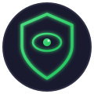

<p align="center">
  
</p>

<h1 align="center">PeepGuard</h1>

<p align="center">
  <strong>Your personal shoulder-surfing guardian</strong><br>
  Instantly blur your screen when someone is looking over your shoulder
</p>

<p align="center">
  <a href="#installation">Installation</a> •
  <a href="#features">Features</a> •
  <a href="#how-it-works">How It Works</a> •
  <a href="#configuration">Configuration</a> •
  <a href="#building">Building</a>
</p>

<p align="center">
  
  
  
  
</p>

---

## What is PeepGuard?

Working at a coffee shop? Open-plan office? Train commute? **PeepGuard** watches your webcam and automatically blurs your screen when it detects someone looking at it from behind you.

**No cloud. No photos stored. Everything runs on your device.**

The moment they look away, your screen comes back. It's like having a privacy screen protector that only activates when you need it.

## Features

- **Instant Protection** — Screen blurs within 1-2 seconds of detection
- **Face Recognition** — Learns your face so it knows you from everyone else
- **Smart Detection** — Distinguishes real people from posters, photos, and statues
- **Zero Cloud** — All processing happens locally on your machine
- **Low Overhead** — Uses ~15% of one CPU core at 8 fps
- **Cross-Platform** — Works on macOS and Linux
- **Customizable** — Adjust sensitivity, timing, and actions via config file

## Installation

### From Source (Recommended)

```bash
# Clone the repository
git clone https://github.com/sweelam/peepguard.git
cd peepguard

# Install with pip
pip install -e ".[shield]"

# Fetch the face detection model (230 KB, one-time)
peepguard fetch-model

# Run PeepGuard
peepguard ui
```

### Pre-built Installers

Download from the [Releases](https://github.com/sweelam/peepguard/releases) page:
- **macOS**: `PeepGuard-x.x.x-mac.dmg`
- **Linux**: `.deb` package or `.AppImage`

## Quick Start

```bash
# Launch the graphical interface
peepguard ui

# Or run headless with on-screen HUD
peepguard run --hud
```

On first launch, PeepGuard offers to learn your face (~15 seconds). This is optional but recommended — it helps distinguish you from others, so colleagues or family members won't accidentally trigger the shield.

## How It Works

PeepGuard uses three key techniques to reliably detect shoulder surfers:

### 1. Screen-Aware Gaze Detection
Instead of just measuring head rotation, PeepGuard calculates whether someone is actually **looking at your screen**. A person at the edge of the frame facing your direction has a different gaze angle than someone directly behind you.

### 2. Liveness Detection
Real people breathe, shift weight, and move their heads slightly. PeepGuard tracks this motion relative to the background, filtering out photos, posters, and mannequins. Someone who freezes mid-read still counts — liveness latches once proven.

### 3. Temporal Filtering
Nothing fires on a single frame. An onlooker must persist for over a second, and the shield only drops after clear frames for 1.5 seconds. This prevents false alarms from people walking past.

```
┌──────────────┐    ┌──────────────┐    ┌──────────────┐    ┌──────────────┐
│   Webcam     │───▶│  Face Detect │───▶│  Pose + Gaze │───▶│   Decision   │
│   8 fps      │    │    YuNet     │    │   Analysis   │    │    Engine    │
└──────────────┘    └──────────────┘    └──────────────┘    └──────────────┘
                                                                    │
                                              ┌─────────────────────┴──────────┐
                                              ▼                                ▼
                                       ┌─────────────┐                  ┌─────────────┐
                                       │   Shield    │                  │   Notify    │
                                       │   Screen    │                  │   (opt)     │
                                       └─────────────┘                  └─────────────┘
```

## Configuration

Create `~/.config/peepguard.toml` (Linux) or `~/Library/Application Support/peepguard/config.toml` (macOS):

```toml
# Sensitivity
attention_cone_deg = 28     # Half-angle that counts as "looking at screen"
dwell_s = 1.2               # How long someone must look before triggering

# Camera
flip_horizontal = false     # Mirror the camera
rotate = 0                  # Rotate camera: 0, 90, 180, or 270 degrees

# Behavior
allow_minutes = 15          # Default duration for "Allow" button
away_lock_s = 0             # Shield after N seconds with you out of frame (0 = off)
actions = "log,shield,notify"
```

### Command Line Options

```bash
peepguard run --cone 30          # Wider detection cone
peepguard run --dwell 2.0        # Require longer presence before triggering
peepguard run --sticky           # Shield stays until manually dismissed
peepguard run --source video.mp4 # Replay from video file
```

## Face Enrollment

Teaching PeepGuard your face takes about 15 seconds:

```bash
peepguard enroll    # Guided setup: look straight, left, right, chin up
peepguard forget    # Remove your face signature
```

Your face is stored as a **numeric signature** (128 numbers), not photos. This file is kept locally with restricted permissions and is never transmitted anywhere.

## Building from Source

### Executable

```bash
./packaging/build.sh
# Output: dist/peepguard (Linux) or dist/PeepGuard.app (macOS)
```

### Installer

```bash
./packaging/build-installer.sh
# Output: dist/PeepGuard-x.x.x-mac.dmg or dist/peepguard-x.x.x-linux.deb
```

## Privacy & Security

- **100% Local**: No network requests, no telemetry, no cloud
- **No Photo Storage**: Frames are processed and discarded immediately
- **Face Templates**: Only numeric signatures stored, not images
- **Open Source**: Audit the code yourself
- **Permissions**: On macOS, requires Camera access; Screen Recording is optional (provides frosted blur effect)

## Limitations

- This is a **privacy awareness tool**, not a security control. Determined observers at extreme angles or distances may not be detected.
- The camera LED stays on while PeepGuard is running
- A video of a face (e.g., on a TV) will be detected as "alive"
- Pose estimation accuracy is ~5-10°, which is why timing-based filtering is important

## Contributing

Contributions are welcome! Please feel free to submit issues and pull requests.

```bash
# Install development dependencies
pip install -e ".[dev]"

# Run tests
pytest -q
```

## License

MIT License - see [LICENSE](LICENSE) for details.

---

<p align="center">
  Made with care for your privacy<br>
  <a href="https://github.com/sweelam/peepguard">github.com/sweelam/peepguard</a>
</p>
